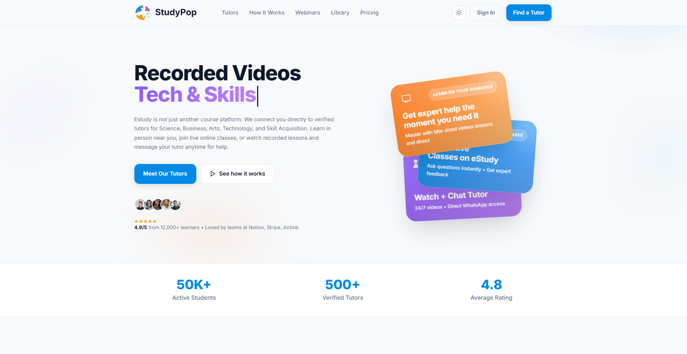

# StudyPod Tutor Dashboard

A responsive, browser-based tutor dashboard for managing courses, students, assignments, quizzes, conferences, email, analytics, and support. Built with vanilla HTML, CSS, and JavaScript, the project is lightweight and requires no build step or backend.

[](https://okeyodev.github.io/studypod-tutor-dashboard/)

## Project Preview



## Live Website

**[View the StudyPod website live](https://okeyodev.github.io/studypod-tutor-dashboard/)**

## Features

- **Dashboard overview** with course, student, completion, conference, and engagement summaries
- **Course management** with course creation, course details, drafts, and performance views
- **Student management** with student profiles, enrollment records, payment records, search, and filters
- **Assignments** with creation forms, submissions, review status, and student work
- **Quizzes** with creation, questions, scoring, and student performance
- **Conferences** with event creation, registration, details, and past/upcoming views
- **Email center** with inbox, compose, sent, drafts, starred, and read/unread state
- **Analytics** for course and student performance
- **Settings and support** pages
- **Light and dark themes** with saved preferences
- **Collapsible desktop sidebar** and responsive mobile navigation
- **Persistent demo data** using browser `localStorage`
- **Shared layout and synchronized counts** across the application

## Technology

- HTML5
- CSS3
- Vanilla JavaScript
- SVG icons
- Browser `localStorage`

No framework, package manager, API key, database, or build process is required.

## Getting Started

### View locally

1. Clone the repository:

   ```bash
   git clone https://github.com/okeyodev/studypod-tutor-dashboard.git
   ```

2. Open the project folder.
3. Open `index.html` directly in your browser, or run a local static server:

   ```bash
   python -m http.server 8000
   ```

4. Visit `http://localhost:8000`.

### VS Code

Open the project in VS Code and use the Live Server extension to preview `index.html`.

## Project Structure

```text
studypod-tutor-dashboard/
├── index.html              # Main dashboard
├── Screenshot.png          # Project preview image
├── assets/                 # Shared images and branding
├── css/                    # Global and page-specific styles
├── js/                     # Shared layout, data store, and page scripts
└── pages/                  # Dashboard management pages
```

Key directories:

- `pages/courses.html`, `course-form.html`, and `course-performance.html`
- `pages/students.html` and `student-profile.html`
- `pages/assignments.html`, `assignment-form.html`, and `assignment-submissions.html`
- `pages/quizzes.html`, `quiz-form.html`, and `quiz-performance.html`
- `pages/conferences.html` and `conference-form.html`
- `pages/email.html`, `email-compose.html`, `email-drafts.html`, and `email-sent.html`
- `pages/analytics.html`, `settings.html`, `support.html`, and `messages.html`

## Data and Browser Storage

The app includes seeded demo data and uses a centralized `Store` module for create, update, delete, filtering, and persistence operations. Data is saved in browser `localStorage`, so changes remain available after refreshing but are specific to each browser and origin.

To reset the demo data, clear the site's local storage in your browser and reload the page.

## Responsive Experience

The interface supports desktop and mobile layouts, including:

- Fixed, collapsible desktop sidebar
- Mobile bottom navigation
- Header theme, notification, and profile controls
- Responsive tables and cards
- Persistent light/dark appearance

## Repository

- **GitHub:** [okeyodev/studypod-tutor-dashboard](https://github.com/okeyodev/studypod-tutor-dashboard)
- **Live demo:** [okeyodev.github.io/studypod-tutor-dashboard](https://okeyodev.github.io/studypod-tutor-dashboard/)
